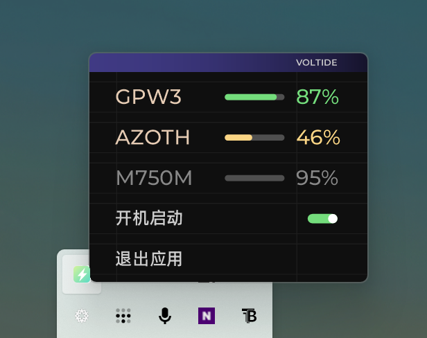

# Voltide


一款轻量的 Windows 托盘工具，在一块面板中显示 2.4G 无线外设（键盘与鼠标）的电量，无需安装任何厂商软件。

> **v2.2.2**：应用图标改为青柠绿到薄荷青的圆角渐变白闪电。托盘在最低电量 100% 时使用这枚新图标；没设备仍是透明底细框闪电，0–99 仍是透明底细框加数字。详见 [RELEASE_NOTES.md](RELEASE_NOTES.md)。
>
> **本 Fork 更新说明（v2.2.0）**
>
> 基于 sdparklab/Voltide v2.1.3 的增强版，新增：
>
> - **低电量提醒**：设备电量跌破阈值时弹 Windows 系统通知（每个低电周期只提醒一次，充电即静音，回升阈值 +5% 后才允许下次提醒）。默认阈值 20%，面板右下角新增「低电量提醒」开关，托盘菜单可选 10%/20%/30% 或关闭，设置自动保存。
> - **ROG 耳机支持**：新增 `AsusHeadsetProvider`，支持 ROG Delta II（凌镜2）等走 2.4G 接收器的 ROG 无线耳机读取电量与充电状态（协议 `CC 12 07` / `CC 12 08`，参考 G-Helper 的实现）。
>
> 详情见 [Releases](https://github.com/Cantrarella/Voltide/releases)。

目前已内置罗技、迈丛、ROG 三家适配器。这是作者手头拥有的设备，而非工具的能力边界：适配层被设计成「支持一个新品牌 = 新增一个独立的类」。


*三台设备：89% 放电中、47% 中等电量，以及一台休眠设备保留着最后一次读数。*


*四台设备——超过三台时，卡片行可用鼠标滚轮横向翻阅。*

若你使用的设备尚未被支持，可以通过 Issue 提出。作者也欢迎借用设备进行实测，并据此补充对应型号的适配。

## 功能

- **一块面板容纳全部设备。** 卡片自动排布并居中；设备接入即出现。超过三台时，卡片行可用鼠标滚轮横向翻阅。
- **液面指示。** 闪电随电量注满，面板打开时有缓慢的波动。
- **三档配色。** 50% 及以上为绿色，20% 至 49% 为黄色，20% 以下为红色。百分比与液面同步变色。
- **准确的休眠状态。** 曾经上报过的设备在休眠时保留最后一次读数并变暗——一台睡着的鼠标仍然能提供信息。
- **可调刷新间隔。** 面板打开时可选 15 秒、30 秒或 90 秒，设置会被保存并在下次启动时恢复。
- **低电量提醒。** 电量跌破阈值时弹出 Windows 系统通知；面板右下角一键开关，阈值可在托盘菜单调整（10%/20%/30%），每个低电周期只提醒一次，充电时静音。
- **托盘集成。** 左键打开面板，右键菜单列出每台设备及其当前电量。
- **开机自启。** 可选，在托盘菜单中切换。
- **单文件发布。** 8.3 MB，无安装程序，除 Windows 自带的 .NET Framework 外无其他依赖。

## 当前已支持

以下设备均已在真实硬件上验证。它们代表作者手头拥有的设备，而非架构所能覆盖的上限。

| 品牌 | 型号 | 协议 |
|---|---|---|
| 罗技 | G304、G Pro X Superlight 2（GPW3）、M750M、G102 等 | HID++ 2.0，经由 LIGHTSPEED / Logi Bolt / Unifying |
| 迈丛 MCHOSE | K99 v2、G75 Pro | 厂商自定义 HID，20 字节帧 |
| ROG | AZOTH EXTREME（夜魔 Extreme） | ROG OMNI RECEIVER，64 字节帧 |
| ROG | Delta II（凌镜2）等 ROG 无线耳机 | 2.4G 接收器，64 字节音频通道，0xFF00（`CC 12 07`/`CC 12 08`），协议参考 G-Helper，待实机验证 |
| 雷蛇 Razer | 毒蝰终极版、毒蝰 V3 Pro、炼狱蝰蛇 V3/V4 Pro、巴塞利斯蛇 V3 Pro 等无线鼠标 | 91 字节 Feature Report |
| 雷蛇 Razer | 旋风黑鲨 V2 专业版 | 64 字节音频通道，0xFF00 |
| ATK | A9 Air 大师+（鼠标） | 17 字节，`HidD_SetOutputReport`，和校验 0x4D |
| ATK | N9 V2 Ultimate（耳机） | 64 字节，`WriteFile`，report id 0x55 |
| Xbox | Series X\|S、8BitDo 等 XInput 手柄 | XInput 四档电量 |

> 雷蛇与狼蛛协议的逆向由 B 站网友 木兮丶念旧 完成并分享，特此致谢。
> ATK 系列的适配由 GitHub 网友 [yiwluoq](https://github.com/yiwluoq) 贡献（PR #3），在真实硬件上逆向并验证，特此致谢。

### 如何添加新设备

若你的设备不在列表中，可以在不触碰界面的前提下完成扩展。每个品牌都是一个自包含的适配器：

```csharp
public interface IDeviceProvider
{
    string Name { get; }
    List<DeviceInfo> Discover(List<HidDeviceInfo> catalog);   // catalog 由 DeviceManager 统一枚举
    DeviceReading Read(DeviceInfo device); // 发送查询，解析回复
}
```

添加步骤：

1. 新建 `src/Providers/YourBrandProvider.cs`，实现 `IDeviceProvider`。
2. 在 `src/Core/DeviceManager.cs` 中与现有适配器一并注册。
3. 重新编译。

`Discover()` 会收到系统暴露的全部 HID 集合；`src/Interop/HidNative.cs` 提供枚举能力，`HidSession` 负责读写。现有五个适配器是复杂度递进的可参考样例，具体帧格式见[协议说明](#协议说明)。

若厂商协议未公开，可以通过抓包还原：运行官方工具，用 [USBPcap](https://desowin.org/usbpcap/) 记录 USB 流量，定位返回百分比的那一次请求。三个现有适配器都是这样写成的。

**欢迎为新增设备提交 Pull Request。** 请附上型号名称与承载电量的原始回复报文，以便核对。

## 使用方法

1. 从 [Releases](../../releases) 下载 `Voltide.exe`。
2. 运行。面板会打开一次，之后常驻托盘。
3. 左键点击托盘图标打开面板，右键查看设备列表。

无需安装、无后台服务、无需管理员权限。



*托盘菜单列出每台设备及其当前电量，并提供刷新间隔与开机自启开关。任务栏上的图标是 v2.2.2 的新应用图标（原图里的旧绿色图标已替换）。*

### 如何理解面板

| 显示状态 | 含义 |
|---|---|
| 彩色百分比 + 已填充的闪电 | 设备在线并正常上报 |
| 灰色百分比 + 空的闪电 | 设备休眠；所示数值为最后一次读数 |
| `--` 与「设备休眠中」 | 设备处于空闲状态，且从未上报过 |

### 设置

- **刷新间隔** —— 面板底部的三个选项（`15s / 30s / 90s`），默认 90 秒。面板隐藏到托盘后，刷新放慢至 5 分钟。
- **开机自启** —— 托盘菜单中的开关。写入当前用户的启动项，无需提权。

## 系统要求

- Windows 10 1903 或更高版本，或 Windows 11
- .NET Framework 4.8（上述系统已内置）

## 构建

```powershell
# 编译（使用 Windows 自带的 C# 编译器）
powershell -ExecutionPolicy Bypass -File build.ps1

# 生成可分发的单文件版本
powershell -ExecutionPolicy Bypass -File pack.ps1 -Target dist
```

三款字体以清单资源的形式嵌入可执行文件，因此产物为单个文件。

## 协议说明

这些协议均非厂商公开。各帧格式已写在对应适配器的文件头注释中。

- **罗技** —— HID++ 2.0。特性 `0x1004` 的功能 1 返回百分比；老款接收器回退到特性 `0x1000`。
- **迈丛** —— 报告 `0x13` 上的 20 字节帧。命令 `0x4A`，第 5 字节为百分比，第 19 字节为前序字节的模 256 校验和。
- **ROG** —— 向接收器的厂商集合（用途页 `0xFF00`）写入 64 字节帧 `02 12 01`。回复的第 6 字节为百分比，第 10 字节为设备上配置的低电量阈值。

有一处值得记录的陷阱：罗技 `0x1004` 的**功能 0** 返回的是电压而非电量——设备空闲时它恒定为 3.85 V，与真实电量无关。返回百分比的是功能 1（`0x1E`）。早期版本读取功能 0，这正是 Voltide 显示的数值与 G HUB 不一致的原因。

## 已知限制

- 从未上报过电量的设备在休眠时无法被查询唤醒，将显示 `--`，直至被使用。
- ROG 接收器同时服务于其他外设。若其配对的是鼠标而非键盘，Voltide 仍会将其标记为键盘。
- 共享同一接收器的无线设备通过接收器上报，而非各自独立上报。
- 同品牌但不同型号的设备会被识别为现有型号。适配层目前按厂商与接口特征匹配，尚未区分具体型号。
- 迈丛与狼蛛共用 USB 标识（`3554:FA09`）。目前仅适配迈丛的查询协议，狼蛛键盘可能被识别为迈丛型号，读数也可能不正确。两者需要通过监听设备主动上报来区分，尚未实现。
- XInput 手柄只能读到**四档**电量（满 100% / 中 50% / 低 20% / 空 5%），不是精确百分比。卡片详情会标注 `XInput 四档`，避免误读为实测值。

## 许可

MIT，详见 [LICENSE](LICENSE)。

设计与开发：[Joko](https://github.com/sdparklab)。
